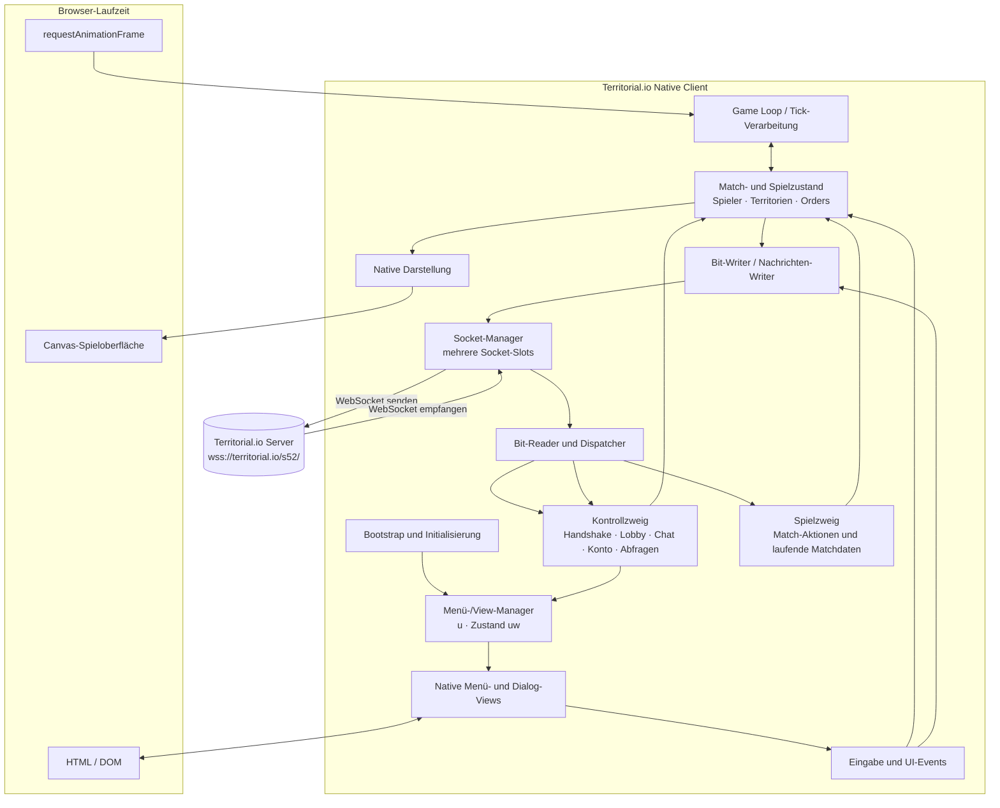
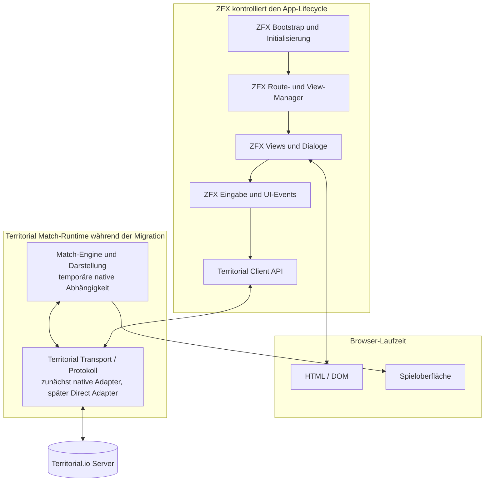
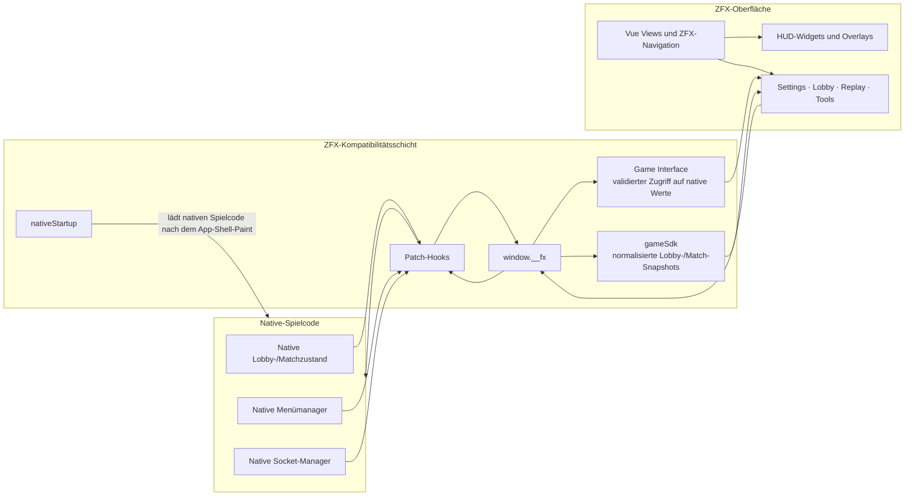

# Native Territorial.io-Architektur

Dieses Diagramm beschreibt den nativen Spielclient, wie er im lokalen `build/game.js` und in den zugehörigen Protokollnotizen erkennbar ist. Das gebaute Skript enthält ZFX-Hooks; native Bestandteile und ZFX-Erweiterungen sind deshalb im Diagramm getrennt markiert. Interne native Bezeichner sind minifiziert und können sich mit einem Spielupdate ändern.

## Laufzeit und Datenfluss

## Verantwortlichkeiten

- **Menüroute und Netzwerk sind getrennte Zustände.** Der native View-Manager (`u`, Feld `uw`) wählt die sichtbare Menüansicht. Ein Routenwechsel startet nicht automatisch einen Socket oder einen Datenfeed.
- **Der Socket-Manager besitzt die Verbindungen.** Der Build verwaltet mehrere Socket-Slots. Handshake, Lobby-/Accountverkehr und Matchverkehr werden anhand von Socket und Sitzungszustand verarbeitet.
- **Das Protokoll hat zwei Zweige.** Kontrollnachrichten tragen Lobby-, Verbindungs-, Chat-, Konto- und Anfrage/Antwort-Daten. Der getrennte Spielzweig transportiert Matchaktionen sowie laufende Matchdaten. Beide verwenden bitgepackte Nachrichten; ihre Untertypen sind nicht austauschbar.
- **Der Matchzustand speist die Darstellung.** Eingaben und Serverdaten ändern den nativen Spielzustand; die laufende Tick-/Render-Verarbeitung aktualisiert die sichtbare Spielfläche. Die genaue interne Render-Engine ist hier absichtlich nicht festgelegt.

## Zielbild: Bootstrap und Navigation gehören ZFX

Ja: Die beiden angesprochenen Kästen im Bild sind **„Bootstrap und Initialisierung“** sowie **„Menü-/View-Manager“**. Im Ist-Zustand gehören sie zum nativen Client. Im Zielzustand liegen beide vollständig bei ZFX. Die nativen Menü-Views und der native Router sind dann keine Laufzeit-Abhängigkeit mehr.

**ZFX entscheidet allein**, welche Route und View aktiv ist. Native Meldungen dürfen ZFX Ereignisse wie `match.started` oder `match.ended` liefern, aber keine Navigation auslösen. Der langfristige Zielzustand entfernt auch die native Match-Runtime; bis dahin bleibt sie als austauschbare Übergangsabhängigkeit hinter der Client API.

### Konsequenz für die Umsetzung

Der heutige Startpfad in `src/modules/main.js` initialisiert zuerst ZFX und ruft nach dem ersten Paint `nativeStartup.initialize()` auf. `src/modules/nativeStartup.js` lädt daraufhin das gebaute `game.js`, dessen nativer Einstieg den internen Objektgraphen und die nativen Views initialisiert. Daher genügt es nicht, nur native Menürouten nicht mehr aufzurufen: Der native Bootstrap muss aus dem Startpfad herausgelöst werden.

Der erste Architektur-Schritt ist, ZFX-Bootstrap und ZFX-Router als alleinigen App-Einstieg festzulegen und die Territorial-Funktionen als optionale Client-API-Implementierung anzubinden. Danach kann die native Implementierung hinter dem Adapter bleiben, während einzelne Domänen ersetzt werden. Solange die Match-Engine noch nativ ist, muss ihre Initialisierung entweder als klarer, isolierter Engine-Start erhalten bleiben oder die Engine selbst ersetzt werden; sie darf nicht mehr den Lebenszyklus der ZFX-App besitzen.

## ZFX-Erweiterung im gebauten Client

Der ZFX-Client läuft zusätzlich im selben Browserfenster. Er lädt seine eigene Vue-Oberfläche, wartet auf deren ersten Paint und startet danach den nativen Spielcode. Hooks im gepatchten nativen Code geben ausgewählte Daten und Aktionen über `window.__fx` an Adapter weiter.

Die ZFX-Schicht ersetzt in diesem Ist-Zustand weder die native Matchsimulation noch den nativen Netzwerktransport. `gameSdk` normalisiert Daten aus nativen Hooks; es ist kein unabhängiger Territorial.io-WebSocket-Client.

## Evidenz und Grenzen

- Der Socket-Endpunkt und ein einfacher Fehlerbericht-Socket stehen am Anfang von `build/game.js`; der eigentliche Native-Socket-Manager, Writer und Dispatcher sind im selben Build enthalten.
- Kontroll- und Spielzweig sowie bekannte Handler sind in [WebSocket-Pakettypen](websocket-pakettypen.md) dokumentiert.
- Menümanager, Route und ihr Verhältnis zu Socket-/Feedzuständen stehen in [Native-Menürouting](native-menu-routing.md).
- Der ZFX-Migrationsstand ist in [Independent WebSocket Client](independent-websocket-client.md) beschrieben.
- Namen wie `u`, `b1.z` oder `aXz.aYa` sind interne Bezeichner des untersuchten Builds, keine stabile API. Bedeutungen unbekannter Protokollfelder und interne Rendering-Details bleiben offen.
